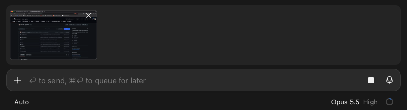

# appshot

Appshots for Claude Code on macOS: press both Command keys in any app and the
frontmost window (a screenshot plus the text macOS Accessibility exposes) lands
in the Claude session you used last, as a thumbnail above the prompt box. Type
your question and send; the capture goes with that message, its screenshot and
window text for Claude. The x on a thumbnail's corner drops it before you send.



It has two parts: this Claude Code mod, and a small Hammerspoon script
(`hammerspoon/appshot.lua`) that owns the system-wide hotkey and the capture.

## Install

At the prompt of a terminal session:

```
/plugin install appshot --marketplace malawllaqi/claude-appshot
```

Answer `y` to add the marketplace, then pick a scope. From a shell:

```bash
claude plugin install appshot --marketplace malawllaqi/claude-appshot
```

In the Claude desktop app, where `/plugin` does not run: click + next to the
prompt box, then Plugins, Add marketplace with `malawllaqi/claude-appshot`,
then Add plugin.

## Set up the hotkey helper

1. Install Hammerspoon: `brew install --cask hammerspoon`
2. Clone this repository and run `hammerspoon/install.sh`. It copies
   `appshot.lua` into `~/.hammerspoon/` and loads it from `init.lua`.
3. In System Settings > Privacy & Security, turn on Hammerspoon under
   **Accessibility** and **Screen & System Audio Recording**, then quit and
   reopen Hammerspoon (macOS applies Screen Recording only on a fresh launch).

## Use

- Both Command keys, or ctrl+alt+cmd+A: capture the frontmost window.
- `/appshot` in Claude: capture the window behind Claude.
- `/appshot <question>`: capture it and send the question right away.

The capture goes to the session on screen. The Claude desktop app starts a
session only when you send its first message, so in a session you just
opened the capture waits, and that first message picks it up and carries it.
Every sent message that carried captures shows their thumbnails under it.
A capture only ever waits; nothing is sent until you send it
(`/appshot <question>` aside). Captures are kept in
`~/Library/Application Support/AppShot/claimed/`; ones nobody picks up within
10 minutes move to `expired/`.

## Notes

- Some apps expose little text through Accessibility; Claude then works from
  the screenshot alone. Chromium and Electron apps are asked to expose their
  tree on the first capture, so that one may hold only the app's controls.
- The first time Claude opens a screenshot it may ask for permission, since
  the file sits outside your project.

## License

MIT
